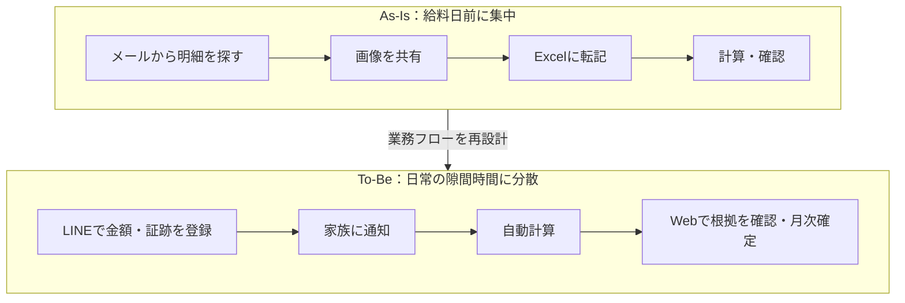
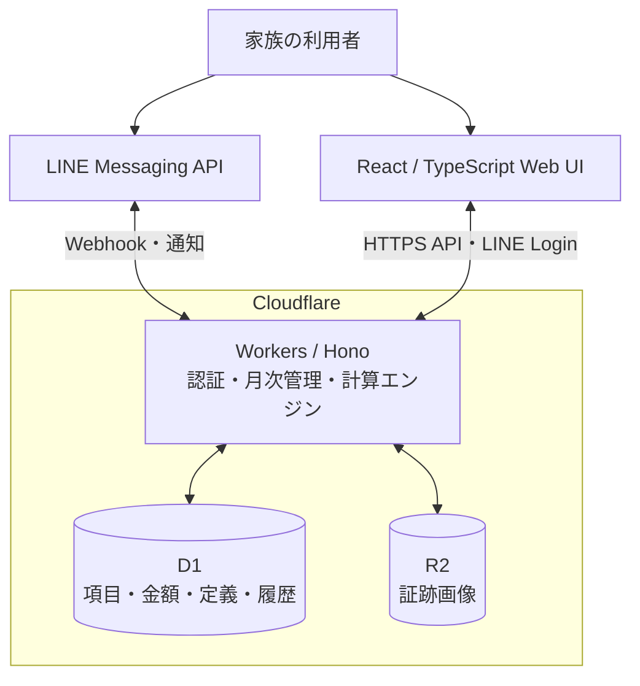
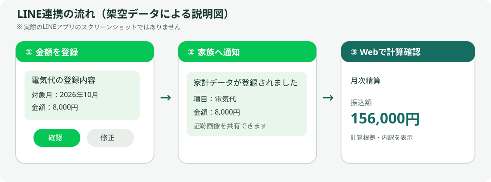

# LINE連携 家計管理・月次精算システム

[](https://github.com/hoheto116/household-finance-portfolio/actions/workflows/portfolio-check.yml)

> **個人開発 / Cloudflare上で実運用中**  
> Excelに集中していた夫婦の月次精算を、LINEからの随時登録・自動計算・家族間の情報共有へ改善したプロジェクトです。

## プロジェクト概要

| 項目 | 内容 |
| --- | --- |
| 利用者 | 家族（夫婦） |
| 課題 | 給料日前に明細収集・転記・計算が集中 |
| 従来の作業 | 毎月約20〜30分 |
| 導入後 | LINEで日常的に登録し、Webで追加登録・設定・月次精算・履歴確認 |
| 効果 | **作業負担が体感で約80%軽減**（実測値ではありません） |
| 担当 | 課題発見、要件・設計方針、Codexへの実装指示、検証、デプロイ、運用 |

**主要資料：** [AI開発プロセス](docs/ai-development-process.md) ｜ [Web管理・月次業務](docs/web-workflow.md) ｜ [実装・テストコード](showcase/README.md) ｜ [独立デモ](examples/README.md)

## 実運用画面（掲載準備中）

LINEでの入力・家族通知、Webでの月次計算・計算式編集・ユーザー項目追加・招待承認の6画面を掲載予定です。個人情報等をマスキングした実画面を使用し、独立デモとは区別します。

[画面一覧と技術的な見どころ](docs/screenshots.md)

## 1. Codexを使った開発プロセス

| 開発者が主導 | Codexで支援 |
| --- | --- |
| 課題の発見・要件整理 | UI・APIの実装 |
| アーキテクチャとデータモデルの方針決定 | マイグレーション・テスト作成 |
| 受入基準・動作検証・修正判断 | 反復的な改修 |
| デプロイと実運用 | 実装案・改善案の提示 |

**AIにコードを書かせることではなく、設計意図を伝え、実装を検証し、利用者の課題解決までつなげること**を重視しました。

[AI開発プロセスの具体例（計算エンジン・LINE連携）](docs/ai-development-process.md)

本プロジェクトは個人開発です。別途、GitLab・Bitbucket・AWS CodeCommitでのチーム開発、ブランチ運用、MR/PRによるレビュー経験があります。GitHubでのチーム開発経験とは区別しています。

## 2. 主な機能 — LINEとWebの役割

LINEは日常の入力・通知の窓口、Webは設定から月次登録、精算、履歴確認までを担う管理画面です。Webは単なる閲覧画面ではありません。

| 業務 | LINE | Web |
| --- | --- | --- |
| 日常の基本項目登録 | 金額・証跡画像・確認操作 | 月次入力・証跡管理 |
| 家族間の情報共有 | 登録通知・証跡共有 | 登録内容・計算根拠の確認 |
| 基本項目以外の月次登録 | — | 追加項目を含む月次入力 |
| 設定 | — | 項目・固定値・計算定義などの管理 |
| 月次精算・締め | 状況照会・確定・振込証明・完了 | 計算確認・振込額確定・振込証明・月次完了 |
| 過去月の結果確認 | — | 確定済み結果・計算内訳の参照 |

※各チャネルの主な役割を示した表であり、全機能の対応可否一覧ではありません。

Webでは、設定した家計ルールに基づいて月次データを登録し、計算結果を確認して締め処理を行い、過去月の確定結果を参照できます。日常入力と管理業務を分離しながら、共通のAPI・データ・計算ルールを利用する構成です。

[Web管理画面の構成・月次状態遷移・設計の詳細](docs/web-workflow.md)

### As-Is / To-Be — 何を改善したか



改善の中心は、計算の自動化だけでなく、**明細の収集と入力を日常の非同期作業へ変えたこと**です。夫婦のどちらが登録しても、もう一方が通知と証跡を確認できます。

## 3. システムアーキテクチャ



| 領域 | 技術 |
| --- | --- |
| フロントエンド | React / TypeScript |
| API | Cloudflare Workers / Hono / TypeScript |
| データベース | Cloudflare D1 |
| 画像保存 | Cloudflare R2 |
| LINE連携 | Messaging API / LINE Login |

## 4. 技術的な設計判断

### 計算式をデータとして管理

支払い項目や計算式をコードに固定せず、**構造化された式定義**として保存。任意のJavaScriptを実行するのではなく、許可した演算子のみを評価します。

- 式の深さ・ノード数の制限
- 項目参照の検証と依存関係の循環検出
- 整数・端数処理を考慮した計算
- 計算過程を確認できる内訳表示

**設計意図**：家計ルールの変更に、計算エンジン自体の改修なしで対応するため。

### 月次確定後の再現性

月次確定時の計算結果をスナップショットとして保存し、後から計算設定が変わっても過去の確定結果を参照できるようにしています。更新時の競合検出も考慮しました。

**設計意図**：金額を扱うシステムとして、過去の結果の再現性と更新の整合性を保つため。

### 認証・外部連携

LINE WebhookのHMAC-SHA256署名検証、LINE Login、管理者・メンバーの権限制御、HttpOnly Cookieとハッシュ化したセッショントークンなどを採用しています。

**設計意図**：家族の金銭情報と証跡を扱うため、外部リクエストの検証とアクセス制御を明確にするため。

## 5. 実装コード（実アプリからの抜粋）

応募先がコードの品質を確認できるよう、実運用アプリのコードを一部掲載しています。

- [計算エンジン（TypeScript）](showcase/calculation-engine.ts) — 循環参照、計算式検証、BigInt有理数、丸め
- [計算式の表示（React）](showcase/Formula.tsx) — 計算根拠の可視化
- [月次概要（React）](showcase/MonthlyOverview.tsx) — 状態遷移と集計の表示
- [計算設定（React）](showcase/CalculationSettings.tsx) — 再帰的な式エディタと設定更新競合への対応
- [月次詳細（React）](showcase/MonthlyDetails.tsx) — 過去月・計算根拠・証跡の参照
- [LINE Webhook署名検証](showcase/line-domain.ts) — HMAC-SHA256・入力検証
- [LINEメッセージ・画像通信](showcase/line-client.ts) — LINE APIとの連携
- [LINE通知画像の安全な配信](showcase/line-notification-images.ts) — 非公開R2と期限付きURL
- [実際の結合テストからの抜粋](showcase/selected-tests.test.mjs) — 認証・CSRF、式検証、LINE署名検証
- [実装抜粋の説明](showcase/README.md) — 実行条件、AIとの開発分担

これらは**実装ファイルの抜粋**であり、単体で起動する完成アプリではありません。動作する独立デモは [examples](examples/README.md) を参照してください。

## 6. 架空データで試せるサンプル

実データを含まない、**独立した説明用デモ**を追加しました。LINE連携の流れも、架空データによる説明図で示しています。



- [月次計算のHTMLデモ](examples/monthly-demo.html) — ブラウザで表示できる再現画面
- [架空のテストデータ](examples/demo-data.json)
- [計算ロジックの簡易サンプル](examples/calculation-demo.mjs)
- [実行手順・実アプリとの差異](examples/README.md)

```bash
node examples/calculation-demo.mjs
```

このサンプルは**実際のReactアプリやLINEに接続していません**。LINEの図は実画面のスクリーンショットではなく、機能を説明するための図です。実画面キャプチャは個人情報保護のため未掲載です。

## 7. 実運用で確認したこと

LINEからの登録と確認、家族への通知・証跡共有、LINE Login、Webでの月次計算内訳表示を実機で確認しています。

**今後の課題**：障害時の再送・復旧に関する網羅的な検証、OCRによる明細読み取り、月次分析・予測など。これらは現時点で実装済みの機能ではありません。

## 8. 公開範囲

このリポジトリは**設計と開発成果を紹介するためのポートフォリオ**です。実運用アプリケーションのソースコードは選定した一部のみ掲載し、家族のデータ、認証情報、請求書画像は含めません。

## 独立テスト・CI

Node.js 24でリポジトリのルートから `npm test` を実行すると、掲載した計算エンジンそのものを架空データで検証する8件の単体テストを実行できます。 `npm run demo` は独立した説明用サンプルを実行します。

GitHub Actionsにも同じコマンドを設定しています。2026-11-24にGitHub Actionsの成功を画面で確認しました。Reactのビルド、LINE連携、元の結合テストはこの検証の対象外です。
