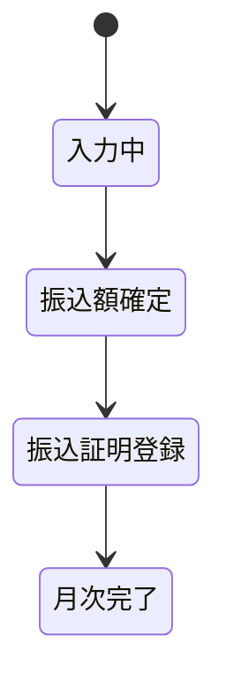

# Web管理画面と月次業務

WebはLINE入力の閲覧専用画面ではなく、家計ルールの設定、月次入力、精算、過去月参照を担う管理画面です。

## 画面構成

| 画面 | 主な操作 |
| --- | --- |
| 月次の家計 | 対象月選択、入力進捗、振込額、未保存入力の確認 |
| 金額と証跡の入力 | 基本項目・追加項目の金額登録、画像登録 |
| 家計の設定（管理者） | 項目定義、固定値履歴、計算式、LINE設定 |
| 計算設定 | 項目参照、演算、丸めを組み合わせた式の編集 |
| 月次締め | 振込額確定、振込証明登録、月次完了 |
| 過去月・計算詳細 | 確定時の計算結果、内訳、証跡の参照 |

## 月次の状態遷移

振込額確定後は金額と証跡の変更を制限する。確定時のスナップショットにより、後から設定を変更しても過去月の確定結果を参照できる。

## フロントエンドの設計

- 計算設定：再帰的な式エディタと設定リビジョンによる更新競合への対応。
- 月次入力：未保存入力がある場合の画面遷移確認、確定ボタンの制御。
- 月切り替え：取得順序の管理やAbortControllerで古いレスポンスの反映を防ぐ。
- 履歴：現在の設定と確定時のスナップショットを区別して表示。
- 権限：管理者向け設定画面と通常の月次操作を分離。API側でも権限を検証する。

## 実装コード

- [計算設定・再帰的式エディタ](../showcase/CalculationSettings.tsx)
- [月次詳細・証跡・過去月参照](../showcase/MonthlyDetails.tsx)
- [月次進捗と集計](../showcase/MonthlyOverview.tsx)
- [計算エンジン](../showcase/calculation-engine.ts)

## 画面資料

上記は実装に基づく画面構成の説明です。実画面キャプチャは個人情報を含まない状態で撮影・確認した後に掲載します。既存の独立HTMLデモは実アプリのキャプチャではありません。
